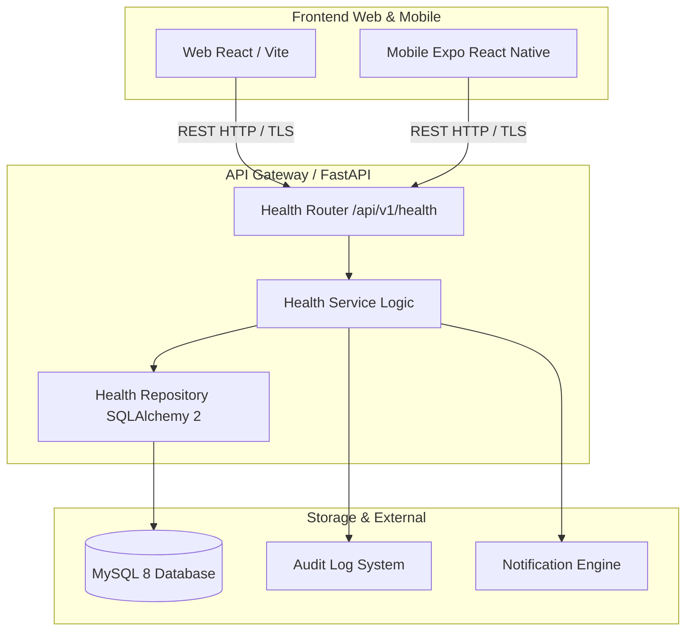

# Architecture Technique — Module « Santé et Bien-être de l'Enfant »

## 1. Vue d'Ensemble & Principes Directeurs

Le module est conçu selon l'architecture hexagonale / monolithe modulaire du projet **TSOTSA for KIDS** :
- **Backend FastAPI** : Module `health` dans `apps/api/src/tsotsa_api/modules/health/`.
- **Persistance MySQL 8** : Tables relationnelles avec clés UUID v7 (`BINARY(16)`), horodatage UTC (`DATETIME(3)`), suppression douce (`deleted_at`), versionnement et traçabilité.
- **Client Partagé** : Intégré dans `packages/api-client`.
- **Frontend Web** : React 18, Vite, Tailwind CSS, composants modulaires `< 300` lignes.
- **Application Mobile** : Expo (React Native), TypeScript, stockage hors ligne sécurisé (`expo-secure-store`) et synchronisation automatique.

---

## 2. Découpage Modulaire Backend

Conformément à `AGENTS.md`, le module backend est strictement cloisonné :
1. **`models.py`** : Définition des entités SQLAlchemy :
   - `SymptomDefinition` (`health_symptoms_catalog`)
   - `ChildHealthEvent` (`child_health_events`)
   - `ChildHealthEventSymptom` (`child_health_event_symptoms`)
   - `ChildHealthAssessment` (`child_health_assessments`)
   - `ChildHealthAlert` (`child_health_alerts`)
2. **`schemas.py`** : Schémas Pydantic v2 assurant la validation stricte des entrées et sérialisation des sorties.
3. **`repository.py`** : Requêtes SQL optimisées avec jointures eagerly loaded pour éviter le problème N+1.
4. **`service.py`** : Logique métier :
   - Calcul automatique de la sévérité (`urgent`, `high`, `attention`, `low`).
   - Déclenchement automatique d'alertes médicales persistées pour les soignants.
   - Enregistrement des audits de consultation et modification des données de santé.
5. **`router.py`** : Endpoints REST protégés par les dépendances de sécurité et permissions RBAC (`require_permission`).

---

## 3. Architecture Frontend Web

- **`apps/web/src/api/health.ts`** : Couche d'accès HTTP sécurisée avec gestion transparente des pannes et fallbacks hors-ligne.
- **`ChildHealthReportModal.tsx`** : Assistant de saisie en 5 étapes accessible aux parents et agents.
- **`ChildHealthCaregiverTimeline.tsx`** : Frise chronologique et dossier clinique soignant.
- **`CaregiverHealthAlertsWidget.tsx`** : Widget de bureau pour les alertes médicales urgentes.

---

## 4. Architecture Mobile Android (Expo)

- **`healthService.ts`** : Gestionnaire des requêtes avec détection de connexion et file d'attente d'événements hors ligne sécurisée via `expo-secure-store`.
- **`u-health-hub.tsx`** : Hub central d'accès au module santé.
- **`u-health-flow.tsx` & `HealthFlowStepViews.tsx`** : Wizard interactif avec interception immédiate des urgences vitales.
- **`u-health-history.tsx`** : Historique simplifié et rassurant adapté aux écrans mobiles.
