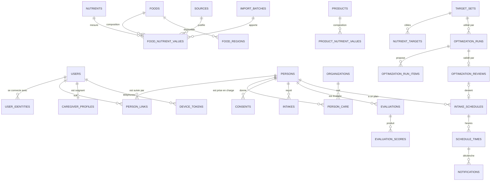

# TSOTSA Kids : modèle de données

Version 1.1 · 5 novembre 2026 (ajout des recettes et de l'extraction ORKG) · base MySQL 8 managée chez OVH · à valider par le Tech Lead

Ce document décrit **toutes les tables** de la plateforme, regroupées par domaine métier. Il est conçu pour que :
- le MVP fonctionne tel qu'il est prévu ;
- le **moteur d'optimisation** (calcul de combinaisons d'aliments et de quantités) puisse être branché plus tard **sans changer la structure**. Toutes les données dont il aura besoin sont déjà prévues.

Antigravity crée ces tables progressivement, module par module (une migration Alembic par étape).

---

## 1. Conventions communes

| Règle | Choix | Pourquoi |
|---|---|---|
| Identifiants | UUID v7 stocké en `BINARY(16)` | Pas d'identifiant devinable ; ordonné dans le temps, donc efficace pour les index MySQL |
| Encodage | `utf8mb4`, moteur InnoDB | Accents, noms locaux, émojis |
| Dates | `DATETIME(3)` en **UTC**, converties dans le fuseau de l'utilisateur à l'affichage | Rappels justes quel que soit le pays |
| Colonnes systématiques | `created_at`, `updated_at`, `created_by` | Traçabilité |
| Suppression | Logique (`deleted_at`) pour les données de santé | Aucune perte, audit possible |
| Valeurs nutritionnelles | `DECIMAL(12,4)` dans l'**unité de référence** du nutriment, **pour 100 g** (ou 100 ml) | Calculs exacts, comparaisons directes |
| Versions | Une correction crée une nouvelle ligne (`version` + `is_current`) | Rien n'est écrasé |
| Isolation par établissement | Colonne `organization_id` sur les données de suivi, filtrée dans la couche repository | MySQL n'a pas d'isolation par ligne native |
| Énumérations | `VARCHAR(30)` + contrainte `CHECK` | Plus simple à faire évoluer qu'un `ENUM` |

---

## 2. Vue d'ensemble des domaines

| Domaine | Tables principales |
|---|---|
| A. Identité et accès | users, user_identities, roles, user_roles, otp_codes, email_tokens, refresh_tokens, caregiver_profiles, invitations |
| B. Organisations et référentiels | organizations, regions, modules, app_settings |
| C. Personnes suivies | persons, person_links, person_care, consent_texts, consents |
| D. Référentiel nutritionnel | nutrients, nutrient_synonyms, units, unit_conversions |
| E. Base aliments (extraite d'ORKG) | food_categories, food_groups, foods, food_names, food_regions, sources, food_nutrient_values, recipes, recipe_ingredients, import_batches, import_batch_rows, orkg_comparisons, orkg_snapshots |
| F. Produits | products, product_nutrient_values, product_essential_nutrients |
| G. Équivalence | equivalence_settings |
| H. Prix | price_records |
| I. Suivi clinique | intakes, evaluations, evaluation_scores, growth_references, alert_rules, alerts |
| J. Plans et notifications | intake_schedules, schedule_times, notification_preferences, device_tokens, notification_templates, notifications |
| K. Optimisation (socle) | target_sets, nutrient_targets, food_constraints, optimization_runs, optimization_run_items, optimization_reviews |
| L. Audit | audit_log |

---

## 3. Les tables, domaine par domaine

### A. Identité et accès (3 façons de se connecter)

| Table | Colonnes principales | Remarques |
|---|---|---|
| `users` | id, display_name, language, status (active / invited / suspended), last_login_at | Un compte = une personne qui se connecte |
| `user_identities` | id, user_id, provider (**google / phone / email**), provider_subject, email, phone_e164, **password_hash**, email_verified_at, phone_verified_at | Un compte peut avoir plusieurs moyens de connexion. Unicité : (provider, provider_subject). `password_hash` seulement pour `email` : **empreinte bcrypt, coût 12**, jamais le mot de passe en clair |
| `roles` / `user_roles` | user, caregiver, admin | Plusieurs rôles possibles |
| `otp_codes` | id, phone_e164, code_hash, expires_at (10 min), attempts, consumed_at | Code SMS haché, 5 tentatives maximum |
| `email_tokens` | id, user_identity_id, purpose (verify / reset), token_hash, expires_at (30 min), used_at | Lien à usage unique |
| `refresh_tokens` | id, user_id, token_hash, device_label, expires_at, revoked_at | Déconnexion à distance possible |
| `caregiver_profiles` | user_id, organization_id, licence_number, document_file, verification_status (pending / approved / rejected), verified_by, verified_at | Aucun accès aux données de santé tant que le statut n'est pas `approved` |
| `invitations` | id, created_by (admin), role, organization_id, phone_or_email, token_hash, expires_at, accepted_at | Comptes créés directement par l'administration |

**Connexion Google :** le serveur vérifie le jeton d'identité Google (signature, audience, expiration), puis cherche `user_identities` (provider = google, provider_subject = identifiant Google). S'il ne trouve rien, il crée le compte.

### B. Organisations et référentiels

| Table | Colonnes principales |
|---|---|
| `organizations` | id, name, type (hôpital, CMA, centre de santé, ONG), region_id, address, status |
| `regions` | id, code, name, country_code |
| `modules` | code (nutrition, hta, diabete), name, status (active / coming_soon / disabled), sort_order |
| `app_settings` | key, value (JSON), updated_by. Exemples : délai de relance, heures calmes par défaut, seuil de présence des nutriments |

### C. Personnes suivies (la famille, sans compte)

| Table | Colonnes principales | Remarques |
|---|---|---|
| `persons` | id, pseudonym (#A-014), first_name, birth_date, sex, region_id | **Pas de compte** : une personne suivie n'a pas besoin de se connecter |
| `person_links` | user_id, person_id, relation (self / child / relative), is_primary | Relie la personne au(x) compte(s) de la famille. Un enfant peut être lié aux deux parents |
| `person_care` | person_id, organization_id, primary_caregiver_id, started_at, ended_at | C'est ce qui rend la personne **visible côté médical** (établissement et soignant) |
| `consent_texts` | id, version, language, body, published_at | Texte versionné |
| `consents` | id, person_id, consent_text_id, given_by_user_id, legal_guardian (oui / non), given_at, withdrawn_at | Pas de consentement actif = pas d'accès soignant |

### D. Référentiel nutritionnel

| Table | Colonnes principales |
|---|---|
| `nutrients` | id, code (protein, fat, iron, phytate…), name_fr, name_en, category (nutrient / antinutrient), reference_unit_id, plausible_min, plausible_max (pour 100 g), is_tracked |
| `nutrient_synonyms` | nutrient_id, label (Protein, Protéines, proteins…) |
| `units` | id, code (g, mg, µg, kcal, kJ, ml, sachet), kind (masse, énergie, volume, portion) |
| `unit_conversions` | from_unit_id, to_unit_id, factor |

### E. Base aliments (extraite d'ORKG, saisie à la main ou par fichier)

| Table | Colonnes principales | Remarques |
|---|---|---|
| `food_categories` | id, name (céréale, légumineuse, oléagineux, fruit, légume-feuille…) | |
| `food_groups` | id, name | Pour les règles de diversité de l'optimisation (par exemple « au moins 2 groupes ») |
| `foods` | id, name, **kind (dish / ingredient / raw)**, scientific_name, category_id, food_group_id, state (cru, cuit, séché…), status (draft / to_review / published / rejected), photo_file | Plats (Condrès, Gari digari), ingrédients (Red millet flour, Digitaria iburua) |
| `food_names` | food_id, language_or_dialect, name | Noms locaux |
| `food_regions` | food_id, region_id, availability (toute l'année / saisonnier), season_months | Sert au filtre par région et à l'optimisation |
| `sources` | id, orkg_comparison_id, orkg_comparison_version, orkg_contribution_id, orkg_contribution_label (ex. Condrès01_Zinc), paper_title, article_reference, doi, url, licence | |
| `food_nutrient_values` | id, food_id, nutrient_id, **value_per_100g** (unité de référence), **basis** (poids frais / matière sèche, partie comestible), **sample_label** (« 01 »), **is_estimated** (calculé à partir de la recette), source_id, batch_id, version, is_current, entered_by, reviewed_by | Une ligne par aliment, nutriment et échantillon. Les écrans utilisent un résumé (moyenne, minimum, maximum). Index (food_id, nutrient_id, is_current) |
| `recipes` | id, dish_food_id, region_id, source_id, version, is_current | Recette d'un plat (comparaisons de type B) |
| `recipe_ingredients` | recipe_id, ingredient_food_id, proportion_pct, importance (basic / optional), position | Contrôle : la somme des proportions doit être entre 98 et 102 % |
| `orkg_comparisons` | comparison_id (R…), type (composition / recipe), nutrient_id (type A), region_id, basis, status (active / replaced), replaced_by, notes | Registre : ce qu'on extrait et comment l'interpréter |
| `orkg_snapshots` | id, comparison_id, fetched_at, method (api / manual_csv), checksum, raw_file, batch_id | Chaque récupération est gardée telle quelle, pour la traçabilité et en cas de panne d'ORKG |
| `import_batches` | id, file_name, file_type (xlsx / csv / manuel / orkg), status (draft / to_review / published / rejected), created_by, reviewed_by, control_report (JSON), rows_valid, rows_error, rows_warning | **Règle : le relecteur doit être différent de l'auteur** |
| `import_batch_rows` | batch_id, row_number, raw_data (JSON), status (valid / error / warning), messages | Conserve chaque ligne du fichier et son diagnostic |

**Saisie manuelle et import de fichier passent par le même circuit** : lot → contrôles → relecture par une seconde personne → publication.

### F. Produits (référence et personnels)

| Table | Colonnes principales | Remarques |
|---|---|---|
| `products` | id, type (reference / custom), name, base (100 g / 100 ml), usage (hospital / home), owner_user_id (si custom), status, source_id, unit_label (sachet, dose) | F-75, F-100, Plumpy'Nut… et produits ajoutés par les familles |
| `product_nutrient_values` | product_id, nutrient_id, value_min, value_max (spécifications en fourchette), source_id | Les spécifications OMS/UNICEF sont souvent des fourchettes |
| `product_essential_nutrients` | product_id, nutrient_id | Nutriments recherchés par défaut dans les équivalences |

### G. Équivalence

| Table | Colonnes principales |
|---|---|
| `equivalence_settings` | nutrient_id (ou NULL pour la valeur par défaut), presence_threshold_pct (le « X % » de la décision D1), updated_by |

Le classement est calculé à la volée à partir des tables E et F. Il n'est pas stocké.

### H. Prix

| Table | Colonnes principales |
|---|---|
| `price_records` | id, region_id, food_id **ou** product_id, price, currency (XAF), quantity, unit_id, observed_at, source, entered_by |

### I. Suivi clinique

| Table | Colonnes principales | Remarques |
|---|---|---|
| `intakes` | id (**UUID créé par le téléphone**), person_id, product_id ou food_id, quantity, unit_id, taken_at, consumption (all / half / refused), schedule_time_id, recorded_by, origin (app / late) | L'UUID du téléphone empêche les doublons après une synchronisation hors ligne |
| `evaluations` | id, person_id, organization_id, caregiver_id, measured_at, weight_kg, length_cm, position (lying / standing), muac_mm, oedema (none / + / ++ / +++), notes | |
| `evaluation_scores` | evaluation_id, indicator (wfl, lhfa, wfa, muac, bmi), z_score, flag (extreme, oedema) | |
| `growth_references` | indicator, sex, x_value (âge en jours ou taille en cm), l, m, s, sd3neg … sd3 | Tables **officielles** de l'OMS, chargées telles quelles |
| `alert_rules` | id, code, parameters (JSON), priority, active | Seuils réglables, validés par la référente médicale |
| `alerts` | id, person_id, organization_id, rule_id, priority, status (open / handled), opened_at, handled_by | |

### J. Plans de prises et notifications

| Table | Colonnes principales | Remarques |
|---|---|---|
| `intake_schedules` | id, person_id, created_by (soignant), product_id ou food_id, quantity, unit_id, start_date, end_date, status, origin (manual / optimization) | `origin = optimization` quand le plan vient d'une proposition du moteur validée par un soignant |
| `schedule_times` | id, schedule_id, local_time (HH:MM), days_of_week, enabled | Une ligne par heure prévue |
| `notification_preferences` | user_id, person_id (ou NULL = global), type, channel (push / sms / email / in_app), enabled, quiet_start, quiet_end | Tout s'active et se désactive à ce niveau |
| `device_tokens` | id, user_id, platform (android / ios / web), expo_push_token, last_seen_at, revoked_at | Jeton supprimé automatiquement s'il est refusé par le service d'envoi |
| `notification_templates` | type, language, title, body (avec variables {prénom}, {heure}…) | Modifiables par l'administration |
| `notifications` | id, user_id, person_id, type, channel, scheduled_for, status (queued / sent / delivered / failed / cancelled), attempts, sent_at, provider_ticket_id, provider_receipt, read_at, **dedupe_key (unique)** | File d'envoi et journal. La clé `dedupe_key` (par exemple schedule_time + date + destinataire + type) interdit tout doublon |

### K. Optimisation (le socle, prêt dès le MVP)

| Table | Colonnes principales | Remarques |
|---|---|---|
| `target_sets` | id, name, condition (MAS, MAM, HTA, diabète…), phase, age_min_months, age_max_months, sex (ou les deux), weight_basis (par kg / par jour), source, status (draft / validated), validated_by | Une population cible validée par la référente médicale |
| `nutrient_targets` | target_set_id, nutrient_id, min_value, max_value, unit_id, per (kg_day / day / meal) | Les contraintes nutritionnelles |
| `food_constraints` | food_id ou product_id, target_set_id (ou NULL = général), min_g_per_meal, max_g_per_meal, max_g_per_day, max_share_pct, allowed (oui / non) | Portions acceptables et exclusions (allergies, âge…) |
| `optimization_runs` | id, person_id (facultatif), target_set_id, region_id, objective (cost / diversity), inputs_snapshot (JSON : aliments, valeurs, prix et contraintes utilisés), solver (HiGHS), solver_version, status (queued / optimal / infeasible / timeout / error), objective_value, duration_ms, explanation (JSON : contraintes déterminantes), created_by | **L'instantané des entrées rend chaque calcul reproductible**, même si la base change ensuite |
| `optimization_run_items` | run_id, food_id ou product_id, grams_per_meal, meals_per_day, daily_cost, nutrient_contributions (JSON) | La combinaison proposée |
| `optimization_reviews` | run_id, reviewer_id (soignant), decision (accepted / modified / rejected), comment, resulting_schedule_id | Aucune proposition n'atteint une famille sans validation d'un soignant |

**Formulation que ces tables rendent possible** (programmation linéaire, Pyomo + HiGHS) :
- variables : `x_f` = grammes de l'aliment f par jour (≥ 0) ;
- objectif : minimiser Σ prix_f × x_f (prix de la région, table H) ;
- contraintes nutritionnelles : pour chaque nutriment n, min_n ≤ Σ valeur_fn × x_f / 100 ≤ max_n (tables E et K) ;
- portions : min_f ≤ x_f ≤ max_f (`food_constraints`) ;
- disponibilité : uniquement les aliments de la région (`food_regions`) ;
- diversité (facultatif) : variables binaires par groupe d'aliments (`food_groups`), donc un modèle linéaire mixte.

### L. Audit

| Table | Colonnes principales |
|---|---|
| `audit_log` | id, actor_user_id, action (read / create / update / delete / login / validate…), entity, entity_id, organization_id, at, ip, details (JSON) |

Les lignes sont uniquement ajoutées, jamais modifiées. Toute lecture ou modification d'une donnée de santé y est tracée.

---

## 4. Schéma des relations principales

---

## 5. Index essentiels (performance)

- `food_nutrient_values (nutrient_id, is_current, value_per_100g)` : recherche d'équivalents.
- `food_regions (region_id, food_id)` : filtre par région.
- `intakes (person_id, taken_at)` : historique et taux de prises.
- `notifications (status, scheduled_for)` : file d'envoi du planificateur.
- `notifications (dedupe_key)` en contrainte unique : aucun doublon.
- `alerts (organization_id, status, priority)` : tableau de bord soignant.
- `person_care (organization_id, person_id)` : isolation par établissement.
- `user_identities (provider, provider_subject)` en contrainte unique.

---

## 6. Ce qui est chargé automatiquement, et ce qui ne l'est jamais

| Chargé automatiquement (référentiels sourcés) | Jamais inventé : saisi ou importé, puis validé |
|---|---|
| Dictionnaire des nutriments et des unités | Aliments et compositions (base ORKG) |
| Tables OMS de croissance | Produits de référence (spécifications officielles) |
| Régions, modules, rôles | Prix, cibles nutritionnelles, limites de portions |
| Textes de consentement et modèles de messages (rédigés et validés) | Personnes suivies, prises, évaluations |
