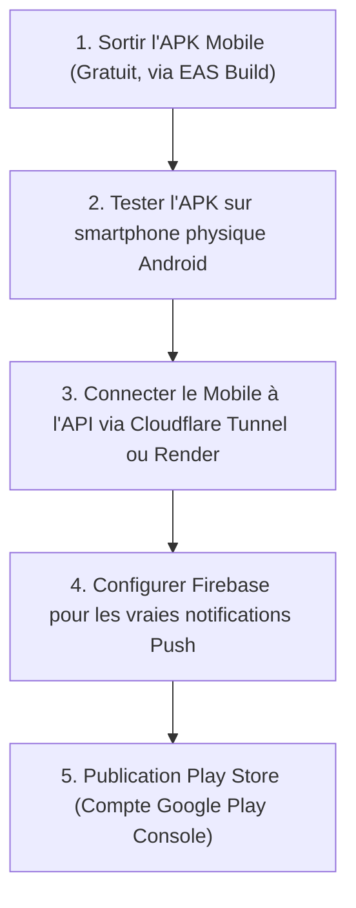

# État des lieux de TSOTSA Kids : Ce qui marche, ce qui ne marche pas et comment le faire marcher

Date du point : 11 novembre 2026  
Projet : **TSOTSA Kids** (Web, Mobile Expo, API FastAPI, Paquet i18n partagé)

---

## Tableau de synthèse (3 colonnes)

| Fonctionnalité / Composant | État actuel (Ce qui marche / Ce qui ne marche pas) | Comment le faire marcher (Actions concrètes) |
| :--- | :--- | :--- |
| **Génération du binaire mobile (APK Android)** | ❌ **Ne marche pas encore** : Aucun fichier `.apk` n'a été compilé pour installation directe sur un smartphone physique. | 1. Installer EAS CLI : `npm install -g eas-cli` 2. Se connecter au compte Expo gratuit : `eas login` 3. Dans `apps/mobile/`, lancer : `eas build -p android --profile preview` 4. Télécharger le fichier `.apk` généré sur le lien fourni par Expo et l'installer sur le téléphone. |
| **Publication sur le Google Play Store (AAB)** | ❌ **Ne marche pas encore** : Le paquet de production `.aab` n'est pas généré et le compte Play Store n'est pas lié. | 1. Créer un compte Google Play Console (25 $ à vie). 2. Lancer la compilation de production : `eas build -p android --profile production` 3. Télécharger le fichier `.aab` et le téléverser dans la console Google Play (piste de test interne ou fermée). |
| **Écrans mobiles Expo (M00 à M31)** | ✅ **Marche à 100 %** : 36 écrans développés et testés (184 tests Jest verts). Authentification (Email, OTP, Google), Espace Famille (enfants, consentements), Aliments locaux, F-75, Prises alimentaires, Bilinguisme FR/EN. | Déjà opérationnel. Pour visualiser en direct sur téléphone : lancer `pnpm --filter @tsotsa/mobile start` et scanner le QR code avec l'application Expo Go. |
| **Portail Web Utilisateur & Soignant (W01 à W20)** | ✅ **Marche à 100 %** : Interface complète responsive, bilingue FR/EN avec sélecteur de langue drapeau et menu fixe. Espace Famille (Nutrition, ajout enfant avec consentement, fiches), Espace Soignant (Dashboard, suivi patients, attribution médecin-chef, évaluations OMS, plan de prises), Espace Admin (Vérification soignants, import, prix, modules). 125 tests Vitest verts. | Déjà opérationnel. Accessible immédiatement en local sur `http://localhost:3080` ou via le serveur SPA intégré. |
| **Liaison Patient - Médecin & Super Soignant (Web)** | ✅ **Marche à 100 %** : Tout enfant créé est lié au Dr Félicité avec rapports et prescriptions visibles. Le mode Médecin-Chef permet de réattribuer les patients entre collègues avec traçabilité et persistance. | Déjà opérationnel dans l'espace soignant (`/soignant/personnes`). |
| **Moteur d'équivalence nutritionnelle & Optimisation (API)** | ✅ **Marche à 100 %** : Algorithme mathématique complet calculant les rations locales équivalentes à F-75, F-100 et Plumpy'Nut selon les 10 régions du Cameroun avec limites anti-nutritionnelles et prix. 164 tests Pytest verts. | Déjà opérationnel dans le code backend Python (`apps/api/src/tsotsa_api/modules/equivalence`). |
| **Connexion Frontend (Web/Mobile) <-> Backend API réel** | ⚠️ **Partiellement actif (Mode magasin local / simulation)** : Le web et le mobile utilisent actuellement des magasins de données réactifs (`localStorage` / `AsyncStorage`) pour fonctionner de manière autonome sans dépendre de l'API déployée. | 1. Renseigner l'URL de l'API dans les variables d'environnement (`VITE_API_URL` pour le Web et `EXPO_PUBLIC_API_URL` pour le Mobile). 2. Remplacer les appels aux stores locaux par les méthodes du paquet `packages/api-client` (déjà généré et typé). |
| **Envoi réel des SMS (Code OTP d'authentification)** | ⚠️ **Simulé en développement** : Le code OTP est généré et vérifié en mémoire/base de test, mais aucun SMS réel n'est expédié sur le réseau téléphonique camerounais. | 1. Ouvrir un compte chez un passerelle SMS (ex. Infobip, Twilio, ou Orange Cameroun SMS API). 2. Renseigner les clés d'API dans `apps/api/.env` (`SMS_PROVIDER=twilio`, `TWILIO_ACCOUNT_SID=...`, `TWILIO_AUTH_TOKEN=...`). |
| **Envoi réel d'E-mails (Invitations, réinitialisations)** | ⚠️ **Simulé en développement** : Les e-mails sont journalisés dans la console sans envoi SMTP effectif. | 1. Configurer un service SMTP transactionnel gratuit (ex. Brevo / Sendinblue ou le serveur SMTP lié au domaine OVH). 2. Renseigner dans `apps/api/.env` : `SMTP_HOST`, `SMTP_PORT=587`, `SMTP_USER`, `SMTP_PASSWORD`. |
| **Notifications Push mobiles sur téléphone physique** | ⚠️ **Simulé dans l'interface** : Les écrans de notification et le planificateur existent, mais les notifications ne réveillent pas encore un smartphone éteint. | 1. Créer un projet Firebase gratuit sur console.firebase.google.com. 2. Télécharger `google-services.json` et le placer dans `apps/mobile/`. 3. Associer le projet dans `apps/mobile/app.json` sous la clé `expo.android.googleServicesFile`. |
| **Hébergement Cloud de l'API 24h/24 (Blocage OVH)** | ❌ **Non déployé sur serveur public** : OVH affiche une rupture de stock sur les VPS dans la région GRA (Gravelines). | **3 solutions immédiates sans attendre OVH :** • **Solution 1 (Immédiate & Gratuite pour tester)** : Déployer l'image Docker de l'API sur **Render.com** ou **Railway.app** en 2 clics depuis GitHub. • **Solution 2 (Alternative VPS européenne à 3,50 €/mois)** : Prendre une instance Cloud chez **Hetzner** (disponible en 30 secondes sans rupture). • **Solution 3 (Attendre réapprovisionnement OVH)** : Réessayer sur OVH en choisissant la région **Strasbourg (SBG)** ou **Roubaix (RBX)** dès que du stock réapparaît. |
| **Base de données MySQL hébergée** | ⚠️ **Fonctionne en local (SQLite / MySQL dev)** : Les migrations Alembic et toutes les tables sont prêtes, mais la base managée en ligne n'est pas encore créée chez l'hébergeur. | Dès que le serveur Cloud est choisi, créer le conteneur Docker MySQL ou activer une base managée et exécuter : `alembic upgrade head`. |

---

## Feuille de route prioritaire pour finaliser l'application

### Prochaine étape immédiate recommandée :
Vous n'avez **aucun besoin de VPS** pour avoir votre application sur votre téléphone dès aujourd'hui.  
Nous pouvons lancer la configuration **EAS Build** pour générer le premier fichier **`.apk` installable** de TSOTSA Kids.
